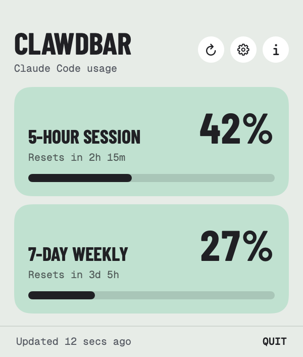
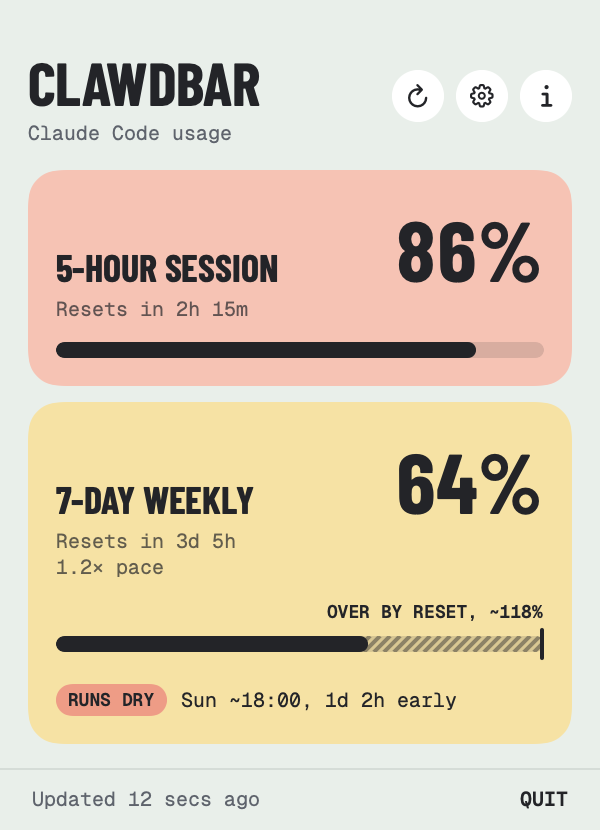
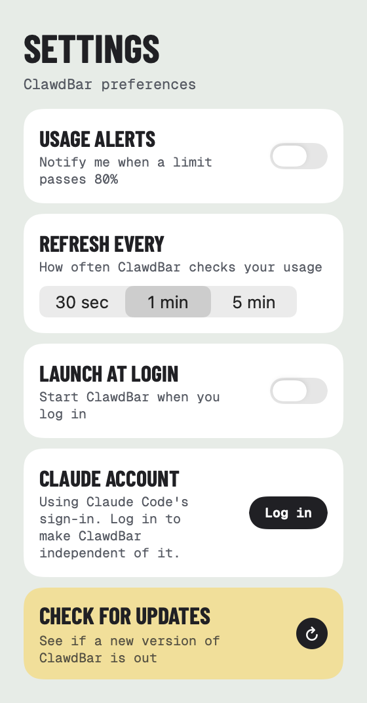
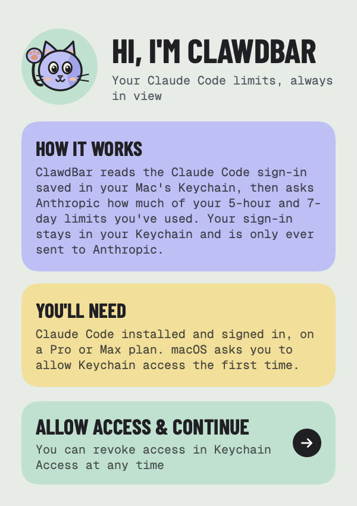

<p align="center">
  
</p>

<h1 align="center">ClawdBar</h1>

<p align="center">
  <strong>Your Claude Code limits, always in view.</strong><br>
  A Mac menu bar app that shows how much of your 5-hour session and 7-day weekly limits you've used.
</p>

<p align="center">
  <a href="https://github.com/RossNicholson/clawdbar/releases/latest"></a>
  
  
  
  <a href="LICENSE"></a>
</p>

<p align="center">
  <picture>
    <source media="(prefers-color-scheme: dark)" srcset="docs/screenshot-dark.png">
    
  </picture>
</p>

<p align="center">
  <a href="#install">Install</a> ·
  <a href="#features">Features</a> ·
  <a href="#how-it-works">How it works</a> ·
  <a href="#privacy">Privacy</a> ·
  <a href="#faq">FAQ</a> ·
  <a href="#build-from-source">Build</a> ·
  <a href="https://rossnicholson.dev/clawdbar">Website</a>
</p>

---

## Install

```bash
brew tap RossNicholson/tap
brew trust --cask rossnicholson/tap/clawdbar
brew install --cask clawdbar
```

Homebrew 7 asks you to trust casks from other taps before installing them. On older versions of Homebrew, skip the `brew trust` line.

Open ClawdBar, then click **Allow access & continue**. macOS asks once for permission to read your Claude Code sign-in from the Keychain.

**Requirements:** macOS 13 Ventura or later · [Claude Code](https://claude.com/product/claude-code) installed and signed in · a Claude Pro or Max plan

### Updating

Open **Settings → Check for updates → Update ClawdBar**, and it quits, updates and reopens on its own. You can also run `brew upgrade --cask clawdbar` in Terminal.

> **On ClawdBar 1.0.6 or earlier with Homebrew 7?** If *Update ClawdBar* doesn't work, update once from Terminal:
> ```bash
> brew upgrade --cask rossnicholson/tap/clawdbar
> ```

---

## Features

- **In your menu bar:** two numbers, like `42% · 27%`, for your 5-hour session and 7-day weekly usage. They're coloured green, then orange from 50%, then red from 80%.
- **At a glance:** click for a colour-block card per limit (mint, then butter, then peach), with the exact percentage, a progress bar and when it resets.
- **Usage alerts:** an optional notification when a limit passes your threshold (50–95%, 80% by default). Each limit alerts once per window, even if ClawdBar restarts.
- **Your pace:** check every 30 seconds, every minute or every 5 minutes.
- **Its own sign-in, if you want it:** ClawdBar normally uses Claude Code's sign-in. You can also log in with Claude directly, so it keeps working when Claude Code's session expires.
- **Launch at login,** light and dark mode, VoiceOver support, and a small cat who waves hello.
- **Native SwiftUI,** with no Electron.

<table>
  <tr>
    <td align="center"><br><sub><b>Busy day</b></sub></td>
    <td align="center"><br><sub><b>Settings</b></sub></td>
    <td align="center"><br><sub><b>First launch</b></sub></td>
  </tr>
</table>

---

## How it works

1. **Your sign-in.** ClawdBar reads the Claude Code sign-in saved in your Mac's Keychain (the `Claude Code-credentials` entry the Claude Code app and CLI create). If you've logged in with ClawdBar itself, it uses that instead. It never changes Claude Code's sign-in.
2. **A tiny check.** At your chosen interval, ClawdBar sends Anthropic's API the smallest request it can (one token, to the Haiku model). It then reads the usage figures Anthropic returns alongside it, in the `anthropic-ratelimit-unified-*` headers. Each check uses a sliver of your limits, about as much as typing "hi".
3. **The numbers.** Those headers give the share of each limit you've used and when it resets. That's everything ClawdBar shows.

ClawdBar's own sign-in uses the same sign-in flow as Claude Code. Anthropic doesn't document it, so a change on their side could mean ClawdBar needs an update.

---

## Privacy

ClawdBar collects nothing: no analytics, no accounts of its own, no tracking.
- Your sign-in stays in your Keychain and is only ever sent to Anthropic.
- The only servers it talks to are Anthropic's: `api.anthropic.com` for your usage, plus Claude's sign-in pages if you use ClawdBar's own login.
- Updates go through Homebrew, as they do in Terminal.

---

## FAQ

**It says "No usage data in the response".**
Usage limits come from Claude Pro and Max plans. On a plan without them (for example API credits only), Anthropic doesn't send the figures ClawdBar reads.

**It says my credentials were rejected.**
Claude Code's session has expired. Open Claude Code to refresh it, or click **Log in** in ClawdBar to give it a sign-in of its own.

**Can I change how often it checks?**
Yes: **Settings → Refresh every**. Fewer checks use even less of your limits.

**How do I uninstall it?**
Run `brew uninstall --cask clawdbar`. Add `--zap` to remove its settings too.

---

## Build from source

```bash
git clone https://github.com/RossNicholson/clawdbar.git
cd clawdbar
make setup   # installs xcodegen if needed and generates the .xcodeproj
make run     # builds and launches
```

The `.xcodeproj` isn't checked in. It's generated from `project.yml`, so run `make generate` after adding files.

| Command | What it does |
|---|---|
| `make test` | Run the unit tests |
| `make dmg` | Build a local signed and notarized DMG (doesn't publish) |
| `make release VERSION=x.y.z` | Ship a release; see [RELEASING.md](RELEASING.md) |

Bug reports, feature ideas and pull requests are welcome. [Open an issue](https://github.com/RossNicholson/clawdbar/issues) to start.

---

## Support

ClawdBar is made by [Ross Nicholson](https://rossnicholson.dev), who also makes [BrewDock](https://github.com/RossNicholson/brewdock). For help, see the [support page](https://rossnicholson.dev/support) or email support@rossnicholson.dev.

If ClawdBar helps you pace your day, you can [buy me a coffee](https://buymeacoffee.com/rossnicholson) ☕

[](https://buymeacoffee.com/rossnicholson)

---

## License

MIT. See [LICENSE](LICENSE).

The bundled fonts, Barlow Condensed and Geist Mono, are under the SIL Open Font License (see `ClawdBar/Fonts`). ClawdBar is an independent app and isn't affiliated with or endorsed by Anthropic. Claude and Claude Code are trademarks of Anthropic.
